# Meeting Room Reservation System

Java를 이용한 회의실 예약 관리 시스템입니다.

사용자가 회의실을 조회하고 예약할 수 있도록 구성했으며,
Java를 활용하여 메뉴 기반의 기본적인 예약 관리 기능을 구현했습니다.

---

## 프로젝트 개요

### 프로젝트명

**Meeting Room Reservation System**

### 프로젝트 목적

회의실을 효율적으로 관리하고 사용자가 원하는 회의실을
간편하게 조회하고 예약할 수 있는 시스템을 구현하는 것을 목표로 합니다.

이번 프로젝트에서는 Java를 활용하여 프로그램의 기본적인 구조를 설계하고,
회의실 조회 및 예약 기능을 단계적으로 구현합니다.

추후 MySQL과 JDBC를 연동하여 회의실 및 예약 데이터를
실제 데이터베이스에 저장하고 관리할 수 있도록 확장할 예정입니다.

---

## 개발 환경

- **Language:** Java
- **Database:** MySQL
- **IDE:** Visual Studio Code
- **Database Connectivity:** JDBC
- **Version Control:** Git / GitHub

---

# Day 1 - 회의실 예약 관리 시스템 기본 기능 구현

## 1. 기본 메뉴 시스템 구현

먼저 회의실 예약 관리 시스템의 기본적인 메뉴를 구성했습니다.

프로그램 실행 시 다음과 같은 메뉴가 출력되도록 구현했습니다.

- 회의실 조회
- 예약 등록
- 예약 조회
- 예약 취소
- 프로그램 종료

사용자가 메뉴 번호를 입력하면 선택한 메뉴에 맞는
기능이 실행되도록 기본적인 메뉴 구조를 구현했습니다.

### 메뉴 출력

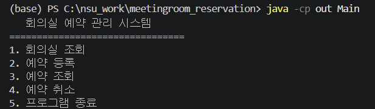

### 메뉴 1번 선택

회의실 조회 메뉴를 선택했을 때 해당 메뉴가 정상적으로
선택되는지 확인했습니다.

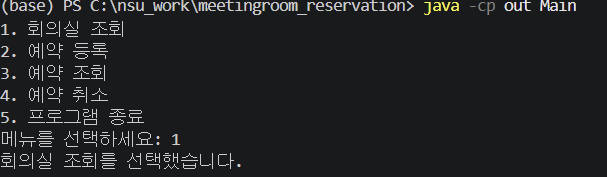

### 메뉴 2번 선택

예약 등록 메뉴를 선택했을 때 해당 메뉴가 정상적으로
선택되는지 확인했습니다.

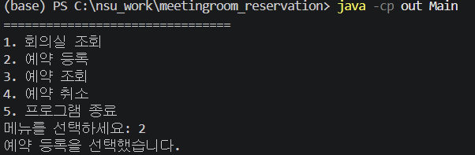

### 메뉴 5번 선택

프로그램 종료 메뉴를 선택했을 때 프로그램이 정상적으로
종료되는지 확인했습니다.

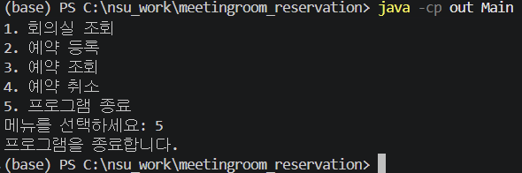

---

## 2. 회의실 목록 조회 기능 구현

기본 메뉴에서 `1. 회의실 조회`를 선택했을 때 등록된 회의실 목록이 화면에 출력되도록 구현했습니다.

회의실 번호와 회의실 이름, 수용 인원을 확인할 수 있도록 구성했으며, 등록된 회의실 정보가 정상적으로 출력되는 것을 확인했습니다.

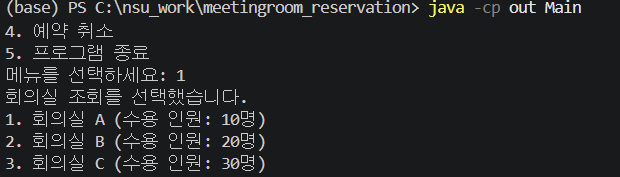

위 화면을 통해 회의실 조회 기능이 정상적으로 동작하는 것을 확인했습니다.

## 3. 예약 등록 기능 구현

기본 메뉴에서 `2. 예약 등록`을 선택했을 때 예약자 이름, 회의실 번호, 예약 날짜를 입력할 수 있도록 구현했습니다.
사용자가 입력한 예약 정보를 화면에 출력하여 예약 등록 과정이 정상적으로 처리되는 것을 확인했습니다.

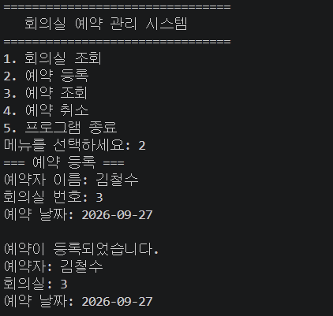

위 화면을 통해 예약자 정보와 회의실 번호, 예약 날짜가 정상적으로 입력되고 출력되는 것을 확인했습니다.
## 구현 기능

- Java 기본 메뉴 시스템 구현
- 사용자 메뉴 선택 기능 구현
- 프로그램 종료 기능 구현
- `Room` 클래스를 이용한 회의실 데이터 구성
- 회의실 목록 조회 기능 구현
- 예약자 이름 입력 기능 구현
- 회의실 번호 입력 기능 구현
- 예약 날짜 입력 기능 구현
- 예약 정보 출력 기능 구현

# Day 2 - 예약 관리 기능 구현

## 1. Reservation 클래스 구현

예약 정보를 하나의 객체로 관리하기 위해 `Reservation` 클래스를 구현했습니다.

예약 번호, 예약자 이름, 회의실 번호, 예약 날짜를 하나의 예약 정보로 관리할 수 있도록 구성했습니다.

또한 예약 정보를 화면에 출력할 수 있도록 기능을 구성하여 예약 조회 및 관리에 활용할 수 있도록 구현했습니다.

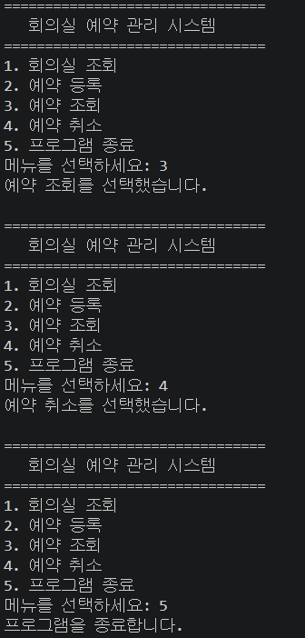

위 화면을 통해 Java 프로그램이 정상적으로 컴파일 및 실행되는 것을 확인했습니다.

## 2. 예약 등록 기능 구현

예약 등록 메뉴를 선택했을 때 예약자 이름, 회의실 번호, 예약 날짜를 입력받도록 구현했습니다.

입력받은 정보를 이용하여 `Reservation` 객체를 생성하고 예약 배열에 저장하도록 구성했습니다.

또한 현재 등록된 예약 개수를 관리하여 새로운 예약이 다음 배열 위치에 저장되도록 구현했습니다.

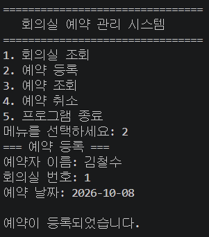

위 화면을 통해 예약자 이름, 회의실 번호, 예약 날짜를 입력하여 예약을 등록할 수 있는 것을 확인했습니다.

## 3. 여러 예약 등록 및 예약 목록 조회

예약 등록 기능을 이용하여 여러 개의 예약 정보를 등록하고, 등록된 예약을 한 번에 조회할 수 있도록 구현했습니다.

김철수와 이영희의 예약 정보를 각각 등록하여 여러 예약 정보를 관리할 수 있는 것을 확인했습니다.

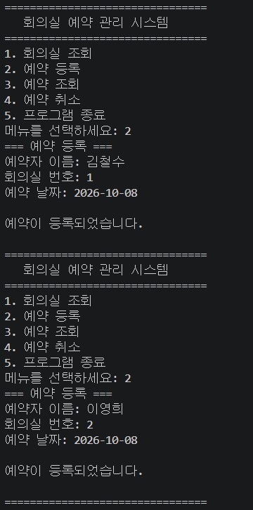

위 화면을 통해 두 개의 예약 정보가 정상적으로 등록되는 것을 확인했습니다.

등록된 예약 정보를 조회했을 때 예약 번호, 예약자 이름, 회의실 번호, 예약 날짜가 함께 출력되도록 구현했습니다.

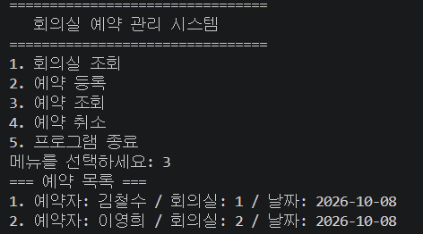

위 화면을 통해 등록된 여러 예약 정보가 정상적으로 조회되는 것을 확인했습니다.

## 4. 예약 취소 기능 구현

등록된 예약을 예약 번호를 기준으로 취소할 수 있도록 예약 취소 기능을 구현했습니다.

사용자가 취소할 예약 번호를 입력하면 해당 예약을 검색하고, 예약 배열에서 해당 정보를 제거하도록 구성했습니다.

예약이 취소된 이후에는 남아 있는 예약 정보가 정상적으로 유지되도록 구현했습니다.

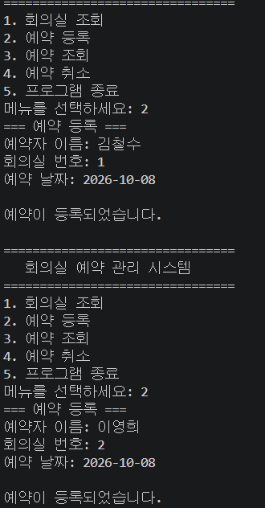

위 화면을 통해 김철수와 이영희의 예약이 정상적으로 등록된 상태를 확인했습니다.

김철수의 예약 번호를 입력하여 예약을 취소한 후 다시 예약 목록을 조회하여 취소된 예약이 목록에서 제거되는지 확인했습니다.

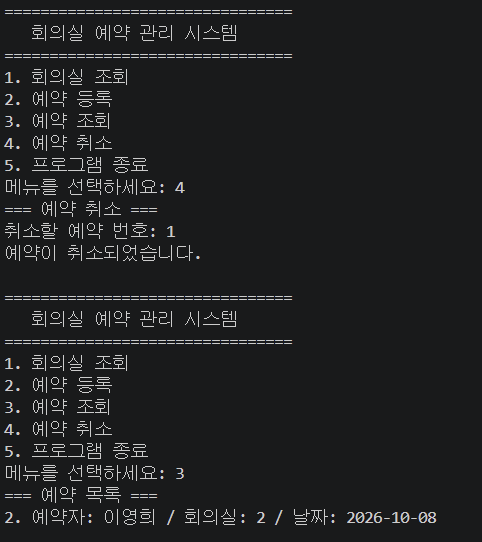

위 화면을 통해 김철수의 예약이 정상적으로 취소되고, 예약 조회 결과에 이영희의 예약만 남아 있는 것을 확인했습니다.

---

# Day 3 - 예약 검증 기능 구현

## 1. 예약 날짜 유효성 검사

예약 등록 시 날짜 형식을 검증하는 기능을 구현했습니다.

- YYYY-MM-DD 형식으로 날짜 입력
- 잘못된 형식이나 존재하지 않는 날짜 입력 방지
- 잘못된 날짜 입력 시 안내 메시지 출력 후 재입력 요청

**실행 결과**

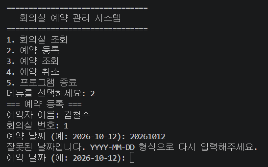

## 2. 회의실 번호 유효성 검사

등록된 회의실 번호인지 확인하는 기능을 구현했습니다.

- 등록된 회의실 번호 확인
- 존재하지 않는 번호 입력 시 오류 메시지 출력
- 올바른 회의실 번호를 입력할 때까지 재입력 요청

**실행 결과**

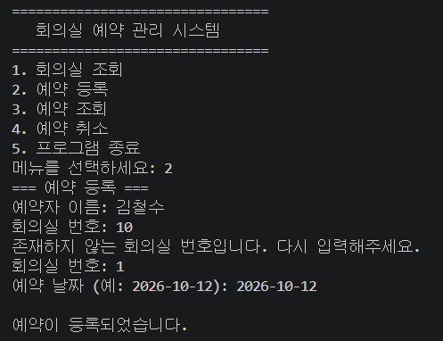

## 3. 중복 예약 방지

같은 회의실에 동일한 날짜로 중복 예약할 수 없도록 구현했습니다.

- 기존 예약 정보와 회의실 번호 및 예약 날짜 비교
- 동일한 회의실과 날짜로 예약 시 중복 예약 방지
- 다른 회의실 또는 다른 날짜는 예약 가능

## 4. 최대 예약 개수 제한

예약 배열의 최대 수용 개수를 6개로 제한했습니다.

- 최대 예약 가능 개수 6개로 설정
- 예약 개수가 최대치에 도달하면 추가 예약 차단
- 최대 예약 개수 초과 시 안내 메시지 출력

**실행 결과**

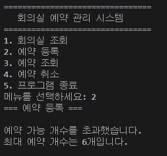

※ 최대 예약 개수 초과 여부를 확인하기 위한 결과 화면입니다. 예약 등록 과정은 생략하고, 예약 가능 개수를 초과했을 때 출력되는 안내 메시지를 확인했습니다.

## 구현 기능

- 회의실 정보 조회
- 예약 등록
- 예약 정보 조회
- 예약 취소
- 예약 날짜 유효성 검사
- 회의실 번호 유효성 검사
- 중복 예약 방지
- 최대 예약 개수 제한

## Day 4 - 예약 시간 관리 및 예약 취소 확인 기능 구현

### 1. 예약 시작 시간 및 종료 시간 관리

예약 등록 시 시작 시간과 종료 시간을 입력하도록 개선했습니다.

- `HH:mm` 형식으로 시간 입력
- 잘못된 시간 형식 입력 시 재입력 요청
- 종료 시간이 시작 시간보다 늦도록 검증

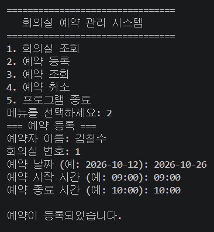

### 2. 예약 시간 중복 방지

동일한 회의실과 날짜에 이미 등록된 예약과 시간이 겹치는 경우 예약을 등록하지 않도록 구현했습니다.

- 동일 회의실 및 날짜의 기존 예약 시간 확인
- 예약 시간이 겹치면 등록 거부
- 기존 예약 종료 시간과 새 예약 시작 시간이 같으면 예약 허용

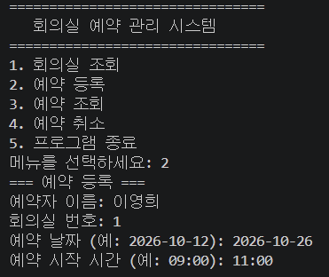

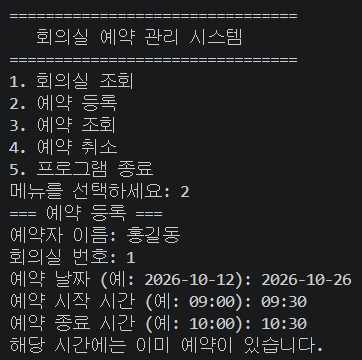

### 3. 예약 취소 전 확인 기능

예약을 취소하기 전에 해당 예약의 상세 정보를 표시하고, 사용자가 취소 여부를 선택하도록 개선했습니다.

- 취소할 예약 번호 입력
- 예약자, 회의실, 날짜 및 예약 시간 확인
- `Y` 입력 시 예약 취소
- `N` 입력 시 예약 유지
- 잘못된 입력 시 예약을 취소하지 않도록 처리

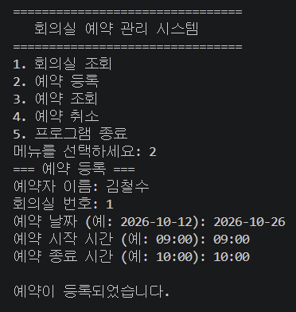

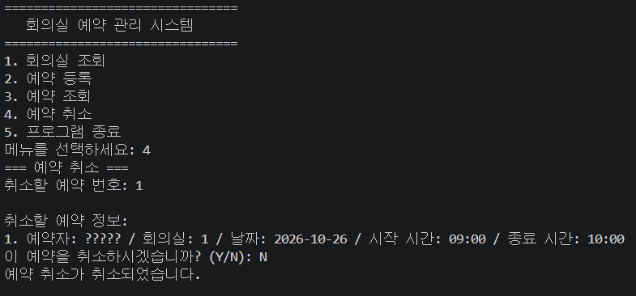

### 4. 예약 취소 결과 확인

취소 여부에 따른 예약 목록의 변화를 조회하여 기능이 정상적으로 작동하는지 확인했습니다.

- 취소 거부 후 기존 예약 유지 확인
- 취소 승인 후 해당 예약 삭제 확인

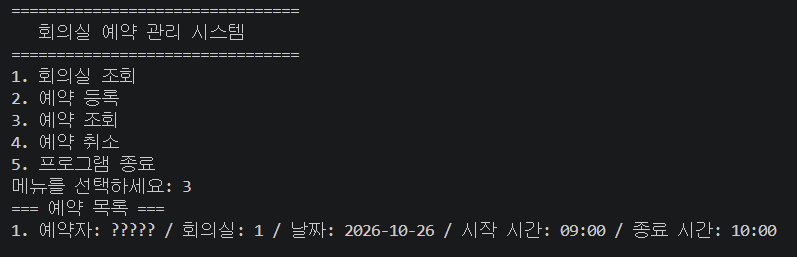

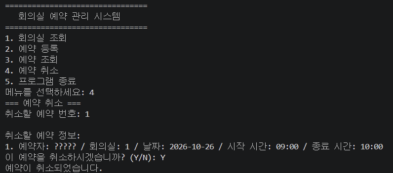

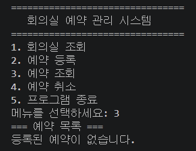

## 구현 기능

- 예약 시작 시간 및 종료 시간 입력
- 시간 형식 유효성 검사
- 종료 시간이 시작 시간보다 늦도록 검증
- 동일 회의실 및 날짜의 예약 시간 중복 방지
- 연속된 시간대의 예약 허용
- 예약 취소 전 상세 정보 확인
- 사용자 확인(`Y/N`)을 통한 예약 취소 처리
- 취소 거부 및 취소 완료 후 예약 목록 조회를 통한 결과 확인